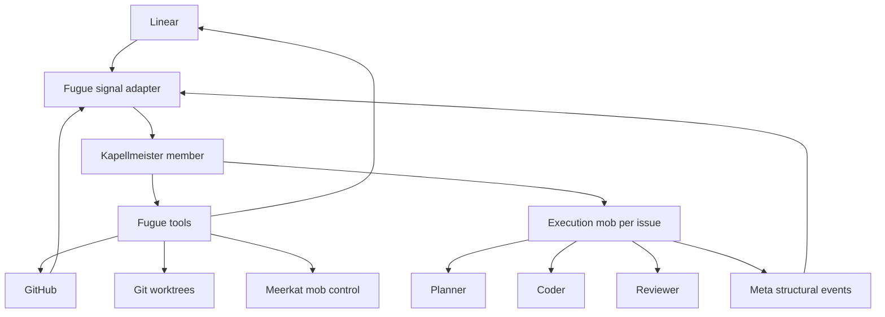

# Native Mob Plan

Use this when working on the end-state Fugue architecture.

The fuller repo-local plan lives at:

```text
/path/to/meerkat-fugue/docs/fugue-native-mob-plan.md
```

## Target

A Fugue instance is a persistent, repo-scoped Meerkat mob led by a Kapellmeister.

The Kapellmeister owns policy:

- Which Linear issues are eligible for work.
- Which mob template should handle an issue.
- Whether a human state change means pause, resume, abandon, replan, or merge.
- When to create a worktree.
- When to spawn or resume an execution mob.
- When to update the Linear workpad.
- When to request human review.
- When to retry, escalate, or stop.
- How to react to PR, CI, review, merge, and mob-flow events.

The host owns mechanism and safety:

- Credentials and authentication.
- Webhook or polling delivery.
- Durable signal delivery and replay.
- Idempotent Linear, GitHub, workspace, and mob-control tools.
- Resource limits, cancellation, and process supervision.
- Safe filesystem boundaries and secret handling.

## Desired Runtime Shape



## Current Staged Path

Completed or current baseline:

1. Native `fugue.yaml` exists beside legacy `WORKFLOW.md` compatibility.
2. New repo onboarding can generate native config, create/reuse Linear resources, deploy to a GCP
   systemd backend, and start the queue with `meerkat-fugue /path/to/repo`.
3. Native execution mob templates are the normal path for generated queues.

Remaining direction:

1. Keep extracting Linear, GitHub, workspace, and mob operations into typed idempotent Fugue tools.
2. Add or widen persistent Kapellmeister authority through shadow or label-gated stages.
3. Improve restart reconciliation from durable Meta state.
4. Retire duplicated legacy policy only after every live queue has migrated or has an explicit
   rollback reason.

Every stage must leave a runnable system and should be implemented through the current Fugue queue
when practical.
