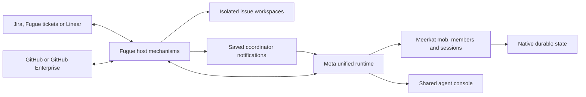

# Architecture

Fugue hosts persistent Meerkat teams for software repositories. Each repository
has its own checkout, tracker/project, queue, credentials and native mob. Jira,
built-in Fugue tickets and Linear use the same issue workflow boundary. GitHub
and GitHub Enterprise provide repository and PR operations.

The managed service exposes one operator application and a shared native Meta
console. Repository preparation forms and initializes domain specialists.
Issue leads and execution members work in that same repository mob and consult
those specialists as work reaches their domains.

## Component diagram

## Authority and boundaries

| Owner | Responsibility |
| --- | --- |
| Repository coordinator (Kapellmeister) | Coordinate repository work, issue leads and final PR handoff through scoped native tools. |
| Issue leads and execution members | Plan, implement and review bounded work; consult specialists and report evidence. |
| Domain specialists | Retain repository knowledge and respond to relevant questions and subscribed path changes. |
| Meerkat and Meta | Native execution, member identity, input admission, session history, lifecycle events, persistence and console state. |
| Fugue host | Poll external systems, prepare workspaces, provide scoped tools, save notifications, enforce delivery safeguards and project typed lifecycle evidence. |
| Tracker | Expose issues, operator actions and configured workflow lanes. The Workpad records human-readable progress and evidence. |

The host does not run a planner/coder/reviewer turn loop or reconstruct native
session history. Tracker status and Workpad prose cannot establish native
completion. A successful merge requires current review, PR, CI and Work Graph
evidence for the actual repository and PR head.

## From issue to delivery

Fugue observes the configured queue and applies admission constraints, including
blockers, existing claims and retry backoff. An eligible issue receives an
isolated workspace and native execution using its selected template. The
repository coordinator and issue team own coordination within that execution.

The host observes native events and external facts, then exposes the configured
tracker projection and guarded repository actions. Children report their work
and review results. Final handoff checks the current evidence before merge and,
if configured, deployment. A tracker lane change alone does not advance native
execution or prove successful delivery.

## Durable notifications

`host_signal_journal` records observations and delivery intent atomically. Its
scope binds the workflow path, runtime path, mob, coordinator and tracker. Jira
scope also includes the query. A saved notification cannot be redirected by
changing a connection or by moving the journal to another repository.

The service drains pending work through native keyed member admission. A lost
or pending response retains the original delivery key and content. Only an
`Admitted` native receipt acknowledges the host record. Native admission supplies
the session/input identity and deduplicates ambiguous retries; the host journal
does not invent a delivery receipt or own agent completion.

If native admission reports terminal non-admission, Fugue records that receipt
and a deterministic replacement key before another attempt. An uncertain result
does not authorize a new key. Database transactions finish before awaiting
native delivery, and saved work can retry independently of tracker reads.

Repository path subscriptions are a separate mechanism: specialists register
their interests, and Fugue observes default-branch changes and notifies matching
members. The coordinator journal does not replace native memory, Work Graph or
the specialist subscription store.

## Recovery model

Fugue retains issue/run associations and delivery evidence; Meerkat and Meta own
native recovery. Diagnostics compare native run identity, workspace branch and
head, Workpad evidence, and the remote PR. Incomplete or contradictory evidence
requires review, not silent completion.

Back up workflow configuration, issue workspaces, host journals and native state
together while the service is stopped or through a supported consistent snapshot.
Reopening a coordinator input after a crash does not authorize repeating an
uncertain merge or deployment. Those actions have their own remote evidence and
durable attempt contracts. See [operations and recovery](./operations.mdx).

## Source tree map

| Source | Purpose |
| --- | --- |
| `src/main.rs` | CLI, server startup and service lifecycle. |
| `src/config.rs`, `src/setup/` | Typed configuration, onboarding and validation. |
| `src/orchestrator.rs` | Observation loop, workspace dispatch, retry mechanisms and handoff checks. |
| `src/tracker.rs`, `src/jira.rs`, `src/fugue_ims.rs` | Tracker adapters and scoped issue operations. |
| `src/host_signal_journal.rs` | Durable observations, delivery intent and native admission acknowledgement. |
| `src/ensemble/` | Team formation, specialist study and repository subscriptions. |
| `src/meta_runtime.rs` | Native runtime composition, member tools and persistent issue/run associations. |
| `src/mob_event_observer.rs`, `src/native_mob_contract.rs` | Typed native lifecycle and handoff evidence. |
| `src/kapellmeister.rs`, `src/kapellmeister_host.rs` | Coordinator signal contracts and guarded host actions. |
| `src/github_tools.rs` | GitHub/GHE PR and check operations. |
| `src/workspace.rs`, `src/workspace_tools.rs` | Issue workspace creation, hooks and cleanup provenance. |
| `src/http.rs` | Operator pages, status API and native console integration. |

## Trust model

Every admitted browser user is a full operator. Repository code, hooks and agent
tools run with the service account's permissions. Typed inputs, scoped tools,
path checks and delivery gates protect application invariants; Fugue does not
provide an operating-system sandbox. Use trusted repositories, an authenticated
gateway, appropriately scoped credentials and separate instances where operator
authority must be isolated.

See [native mobs](./native-mobs.mdx), [the status API](./status-api.mdx) and
[development and testing](./development.mdx) for the detailed contracts.
