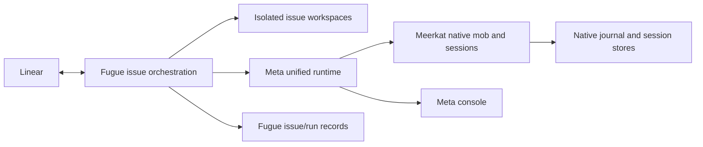

# Architecture

Fugue is a single Tokio service with typed configuration, a Linear tracker,
workspace management, native mob launch, reconciliation, and an optional Axum
status surface.

## Component diagram

## Source tree map

- `src/main.rs` — CLI, logging, HTTP server startup, orchestrator task, and
  shutdown.
- `src/config.rs` — typed config parsing, native defaults, prompt
  rendering, and validation.
- `src/orchestrator.rs` — poll loop, dispatch, retries, backoff, recovery, and
  handoff reconciliation.
- `src/tracker.rs` and `src/linear_tools.rs` — Linear GraphQL client and typed
  Linear tool layer.
- `src/workspace.rs` and `src/workspace_tools.rs` — workspace path invariants,
  hook execution, and cleanup provenance.
- `src/meta_runtime.rs` — persistent Meta composition, native member tools, and durable issue/run records.
- `src/mob_tools.rs`, `src/mob_event_observer.rs`, and
  `src/native_mob_contract.rs` — native Meta execution, event observation,
  and lifecycle evidence checks.
- `src/kapellmeister*.rs` — shadow/guarded policy contracts and host plumbing.
- `src/github_tools.rs` — typed GitHub operations used for PR handoff and CI.
- `src/http.rs` — dashboard and JSON status routes.
- `tests/` — integration and source-only contract tests. `real_e2e` is ignored
  unless explicitly enabled.

## Issue lifecycle

1. **Poll** — fetch issues from configured intake and active lanes.
2. **Filter** — skip blocked, terminal, already running, claimed, or backing-off
   issues.
3. **Select template** — choose a mob template from labels and defaults.
4. **Prepare workspace** — create/reuse the issue workspace and run hooks.
5. **Launch worker** — configs launch a native Meerkat mob.
6. **Observe** — collect Meta events, workspace facts, Linear Workpad state,
   and GitHub PR state.
7. **Reconcile** — validate handoff invariants and move to retry, review, or
   completion.
8. **Cleanup** — remove terminal workspaces through replay-safe cleanup.

## Recovery model

The optional status API exposes in-memory state plus durable recovery evidence.
Native running rows include:

- Meta run id;
- workspace path, branch, head SHA, and dirty flag;
- Linear branch and Workpad run evidence;
- PR mentions from Linear;
- GitHub PR URL, state, and head SHA;
- `review_required` when evidence is incomplete or inconsistent.

Fugue requires human review instead of silent completion when, for example, the
Workpad run id differs from the Meta run id, Linear and GitHub disagree on PR
head, the workspace SHA differs from PR head, or a successful native run lacks
PR handoff evidence.

## Policy boundaries

Fugue separates three concerns:

- **Execution backend** — native Meerkat mobs.
- **Policy owner** — Rust orchestrator by default, with Kapellmeister shadow or
  guarded modes depending on config.
- **Human workflow** — Linear states, Workpad rules, and PR handoff encoded in
  prompts and operator policy.

Kapellmeister shadow mode is read-only. Guarded authority must be narrowed with
safe selectors. Production decisions either execute through guarded native host
tools or stop.

## Trust model

Fugue enforces application-level invariants: typed config, path normalization,
under-root workspace checks, replay-safe cleanup, and evidence reconciliation.
It does not sandbox shell commands, repository code, Meerkat tools, or
credentials.

## Related docs

- [Native Mobs](./native-mobs.mdx)
- [Status Api](./status-api.mdx)

## Runtime ownership in 0.9.3

Fugue stores issue/run associations separately from Meta's member and session
state. The root mob journal and its composition manifest are explicitly durable;
Meta owns restoring them. Meerkat owns execution and tool authority. See the
[upgrade guide](./upgrading-0.9.3.mdx) for state layout and configuration changes.
