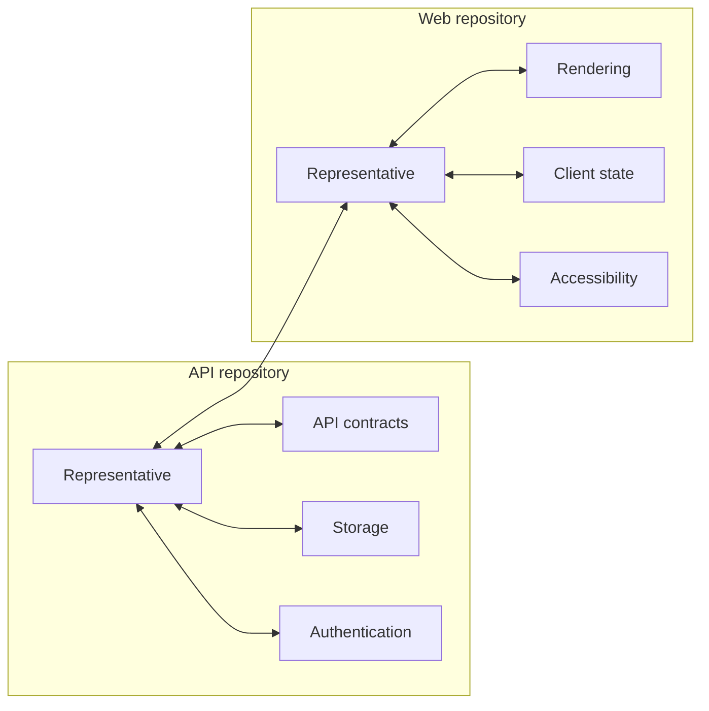

# Ensemble

Ensemble studies every configured Git checkout and automatically builds a
**long-lived team for understanding, developing, and operating that repository**,
plus a stable representative. Their names,
focus, charters, and owned paths come from model-driven inspection of the
repository. Each team retains its native Meerkat conversations and agent memories across tasks and
restarts. Representatives connect teams so they can discuss interfaces and
coordinate work across repositories.

This mode combines [MeerkaT3's persistent project specialists](https://github.com/lukacf/meerkat-t3/blob/main/docs/user/agents.md)
with [Meta Forge's work-driven team design](https://github.com/lukacf/meerkat-meta/tree/main/installer/launchkit).
Formation is fully automatic; it does not stop for proposal approval.
It runs directly against local checkouts and accepts objectives from the cockpit
or CLI. Fugue's existing Linear queue mode continues to serve issue-driven
workflows with their own isolated workspaces.

## Start a team

Configure the provider credentials used by your chosen Meerkat model. To add
repository teams to an existing Fugue workflow:

```bash
meerkat-fugue ensemble init ~/src/api ~/src/web --output ensemble.yaml
meerkat-fugue fugue.yaml --ensemble-config ensemble.yaml --port 8788
```

After formation completes, open **http://127.0.0.1:8788/ensemble** in the regular
Fugue UI. Overview, IMS, Ensemble, and native consoles share one server and
navigation. The Ensemble view shows
the repositories, discovered specialist names, focus, scopes, and native team
state, accepts objectives, and opens each repository's full Meta console on the
same origin. The normal browser authentication also protects Ensemble routes.
An integrated server requires a loopback `--host`.
In the console, select the representative to follow your objective and its
results, or select another team member to inspect that specialist's work.

`--ensemble-config` resolves its file path from the current working directory;
repository and state paths inside that file resolve relative to the file. The
server uses `--port`, then the workflow's `server.port`, then `8788`. It reserves
the port before forming teams, so an occupied port fails before model calls.

For repository teams without an issue queue, use the same team UI in standalone mode:

```bash
meerkat-fugue ensemble serve --config ensemble.yaml
```

This does not require a Fugue workflow or Linear project. Both modes own the
same durable teams when given the same configuration; stop the existing process
before switching modes so only one process holds the state lock.

Initialization creates configuration without making model calls. The first
start performs read-only model-driven formation and prints progress. This step
uses model tokens: a discovery agent examines repository files and submits a
validated team, an independent model reviews coverage and redundancy, and the
discovery agent revises it when necessary. Each created specialist then studies
its own domain. The team is
applied automatically and saved to `{state_root}/{repository_id}/team.json`.

Long-lived describes the agents' durable identities and conversations, not a
continuously running loop. Like MeerkaT3, Ensemble uses native `TurnDriven`
scheduling. After initial formation and domain studies, user or peer messages
drive work. Later starts restore the saved team, sessions, studies, and native memory.

```bash
meerkat-fugue ensemble status
meerkat-fugue ensemble ask api \
  "Ask the relevant specialists to assess the account endpoint and persistence boundary. Summarize risks and verification commands."
meerkat-fugue ensemble ask web \
  "Coordinate with the api representative to understand the user endpoint contract. Propose a compatible frontend change before implementing."
```

Use the repository IDs printed by `init`. The CLI prints JSON responses so it can
also be scripted. An accepted objective means native delivery was admitted; use
the cockpit or console to inspect subsequent work and results.

## How specialists are formed

Discovery starts with a bounded inventory of languages, important paths,
suggested checks, and repository guidance files. The discovery agent then reads
actual source and documentation to identify useful, distinct ownership
boundaries. It might find API contracts, storage, and authentication in one
repository, and rendering, accessibility, and client state in another. These are
examples; the model chooses the domains from the repository it inspects. It
also examines CI/CD, infrastructure, runbooks, and operating duties where
relevant. There is no target team size: enduring responsibilities determine the
team. A 32-specialist structural ceiling bounds formation, and `max_sessions`
must accommodate the resulting team plus its representative.

The discovery result passes through the typed `submit_repository_team` tool.
Every specialist has a stable identifier, a name, a concrete focus, a charter,
and owned repository paths backed by inspected-file evidence. Validation rejects
invalid assignments so the model can correct them. The resulting roster is
reviewed independently before it is saved. The reviewer walks a representative
feature change and an operating or failure scenario to challenge missing
expertise and redundant roles. Rejected teams are revised automatically, with
up to three reviewed attempts. Formation fails explicitly if it cannot produce
a validated, approved team; it never silently falls back to a generic roster.
Review evidence is retained under each repository's `formation/` state directory.

Each specialist then performs an initial read-only study of its assigned domain.
Its conversation retains the resulting understanding for later work. Repository
knowledge is a snapshot: specialists should inspect relevant current files
again before giving advice or making changes. Restarts reuse the saved
assignments and studies rather than inventing a new team.

After initial study, representatives and specialists have native memory tools
to record and recall durable facts, decisions, and lessons. Memory is scoped to
each agent's identity and persists alongside the team's state. It is also
available through the native console's memory view. Agents share findings with
peers through messages; another agent's memory is not automatically shared.
Enabling memory does not start background model work.

Each member has a separate conversation. Native peer messages carry requests,
findings, and replies between them. The representative decides how to involve its
specialists based on the objective and their charters. It also communicates with
other repository representatives.

Capabilities are separate from specialization. A domain specialist can have
read-only repository access or permission to edit files and run commands; its
domain name does not determine its tool permissions. Formation and initial
studies use read-only access. For implementation work, use a dedicated
development checkout and review the resulting diff before merging. Ensemble is
not an operating-system sandbox.

## Configure connections

`init` connects all configured representatives. Use `--no-peers` to begin with
isolated teams, or edit `peers` to describe a smaller network.

```yaml
version: 1
name: Product team
state_root: .fugue/ensemble
model: gpt-5.5
max_sessions: 64
repositories:
  api:
    path: ../api
    description: Owns the public API and database contracts.
  web:
    path: ../web
    description: Owns the browser application and API client.
peers:
  - from: api
    to: web
```

Paths resolve relative to the configuration file. Every repository path must
name an existing Git working-tree root. Duplicate checkout paths, unknown
repository IDs, self-connections, and duplicate connections are rejected.
IDs contain lowercase letters, digits, hyphens, or underscores, begin with a
letter, and are at most 64 characters. Each connection is **bidirectional**.
`max_sessions` applies per repository and must accommodate its representative
and every discovered specialist.

An optional `auth_binding` uses the same typed Meerkat binding reference as the
rest of Fugue. Keep provider secrets out of the file.



The domains in this diagram illustrate one possible discovered team.
Only representatives receive the configured cross-repository connections.
Specialists collaborate through their local native peers. Changes to the
configuration take effect when the daemon restarts.

## Persistence and operation

Keep the configuration IDs, checkout paths, and `state_root` stable to restore
the same team identities and conversations. Each repository has a distinct native
mob and state directory. An ownership manifest binds each repository ID to its
canonical checkout path. Reassigning that ID to another path fails rather than
attaching the existing conversations to another checkout. Temporarily removing
a repository from configuration preserves its reservation and state; use a new
ID or a fresh `state_root` for a different checkout.

Only one daemon may own a state root at a time. An operating-system file lock is
held throughout the native runtimes' lifetime and released when the process
exits. Keep the `ensemble-state.json` manifest with the state directory; a
nonempty directory without its manifest is not adopted automatically.

Meerkat and Meta own member lifecycle, session persistence,
message admission, and comms delivery. The cockpit projects their state rather
than inferring success from a local task record.

Stop the service with Ctrl-C or SIGTERM for orderly native shutdown. Repository
changes remain in the checkout. Back up the configuration and state directory
together. Moving checkout paths requires a deliberate migration; changing the
configured path is not a conversation migration command.

To select another local port:

```bash
meerkat-fugue fugue.yaml --ensemble-config ensemble.yaml --port 8790
meerkat-fugue ensemble status --url http://127.0.0.1:8790
meerkat-fugue ensemble ask api "Review the current diff." --url http://127.0.0.1:8790
```

Both modes expose `GET /api/ensemble` and
`POST /api/repos/{repository_id}/messages` with a JSON `message` string.
The native console is available at `/repos/{repository_id}/console`.

## Related documentation

- [Native mobs](./native-mobs.mdx)
- [Architecture](./architecture.mdx)
- [Upgrading to Meerkat and Meta 0.9.3](./upgrading-0.9.3.mdx)
